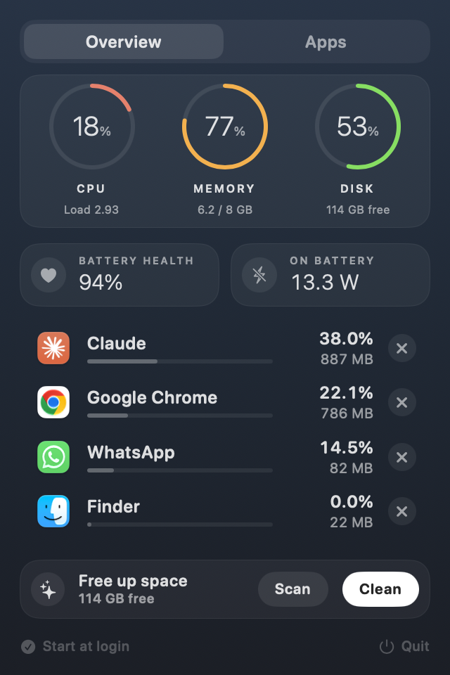
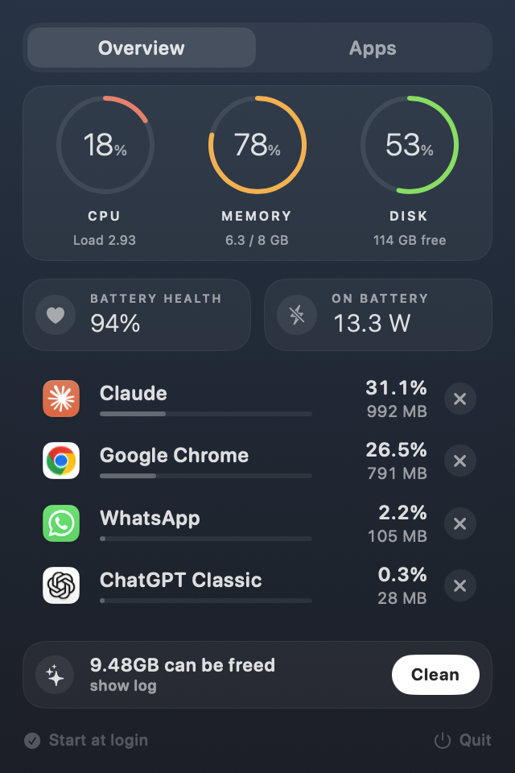
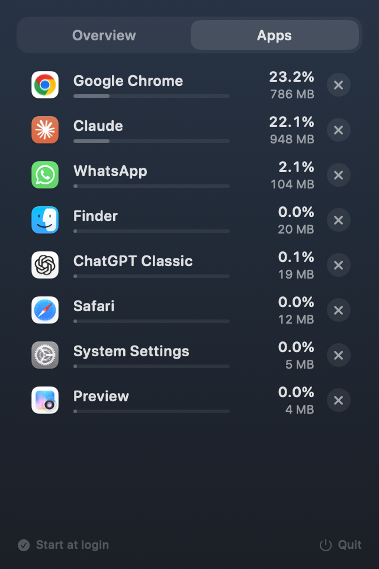

# MoleBar

A small macOS menu bar app that tells you at a glance whether your Mac is healthy, lists what's eating your resources, and cleans up disk space using [Mole](https://github.com/tw93/Mole).

<p align="center">
  
  
  
</p>

## Features

**Menu bar** – a small animated status icon, in the style you pick (right-click → *Menu bar icon*): **Dot** (a breathing orb), **Glass** (empty when Good, half full when Busy, full when Strained), **Heartbeat**, or **CPU %**. Green, amber and red show Good, Busy and Strained; the animation speeds up as your Mac gets busier. Click it for the full picture; right-click for the icon picker, *Start at login* and *Quit*.

**Overview** – everything on one page, no scrolling
- CPU, Memory and Disk rings (they turn amber above 65% and red above 85%)
- **Battery Health** (maximum capacity vs. when it was new) and **Power In** (live watts from the charger, or the Mac's draw on battery) side by side
- The heaviest apps, each with a ✕ to force quit (one confirm; ⌥-click skips it)
- **Free up space**: *Scan* runs `mo clean --dry-run` and shows how much can be freed, then *Clean* runs `mo clean` with a progress bar. The layout doesn't move while it runs, and the full Mole output is behind *show log*

**Look** – a navy background that fades from lighter at the top to darker at the bottom, with a light frosted-glass backdrop that stays dark over bright windows.

**Apps** – every open app, heaviest first (CPU and memory weighed together). Only problem rows are tinted amber or red. Helper processes are rolled up into their app.

## Install

1. Download `MoleBar.dmg` from the [Releases](../../releases) page.
2. Open it and drag **MoleBar** into **Applications**.
3. First launch: the app is ad-hoc signed, not notarized, so macOS will warn. Right-click the app → **Open** → **Open**. If it's still blocked:
   ```bash
   xattr -dr com.apple.quarantine /Applications/MoleBar.app
   ```
4. For **Free up space**, install Mole:
   ```bash
   brew install mole
   ```

Requires macOS 13 or later. The DMG is a universal build (Apple Silicon and Intel).

## Build from source

Only the Xcode Command Line Tools are needed.

```bash
./build.sh        # build/MoleBar.app
./make-dmg.sh     # universal build/MoleBar.dmg
```

Handy for UI work: `build/MoleBar.app/Contents/MacOS/MoleBar --snapshot <dir>` renders the screens to PNGs and exits.

## Notes

- macOS may ask to let MoleBar control **System Events** the first time you run a clean. That prompt comes from Mole, which uses it to detect running apps so it doesn't delete their active caches. It's optional.
- System-level cleanup steps that need `sudo` are skipped, since the app runs Mole non-interactively.
- The Clean progress bar is an estimate based on Mole's section headers.
- macOS refreshes its charger power reading only about every 15 seconds, and can take a while to report charging after you plug in, so the Power In tile can lag the real value.
- **Free up space** shells out to [Mole](https://github.com/tw93/Mole)'s `mo clean`. If Trash isn't emptied, that comes from Mole: it asks Finder to empty it (macOS may prompt for permission) and otherwise needs **Full Disk Access**. Grant Full Disk Access to MoleBar in System Settings → Privacy & Security if you want Trash cleaned reliably.
- MoleBar uses a private macOS interface to hide the popover arrow. That's fine for a GitHub-distributed app but rules out the App Store, and a macOS update could break them.
- **Health** is the battery's full-charge capacity divided by its design capacity, read from macOS's battery registry (the figure System Settings calls *Maximum Capacity*). Desktop Macs have no battery, so the tiles don't appear.

## Project layout

| File | Purpose |
| --- | --- |
| `Sources/MoleBar/main.swift` | Status item, popover, snapshot helper |
| `Sources/MoleBar/SystemStats.swift` | CPU, memory, disk, battery, power sampling and health status |
| `Sources/MoleBar/AppsMonitor.swift` | Per-app CPU and memory |
| `Sources/MoleBar/Cleaner.swift` | Runs and parses `mo clean` |
| `Sources/MoleBar/Views.swift` | SwiftUI interface |
| `assets/` | App icon (`AppIcon.icns`) and the script that renders it |

## Credits

Cleanup is powered by [Mole](https://github.com/tw93/Mole) by tw93. MoleBar is an independent project and isn't affiliated with Mole.

## License

[MIT](LICENSE)
